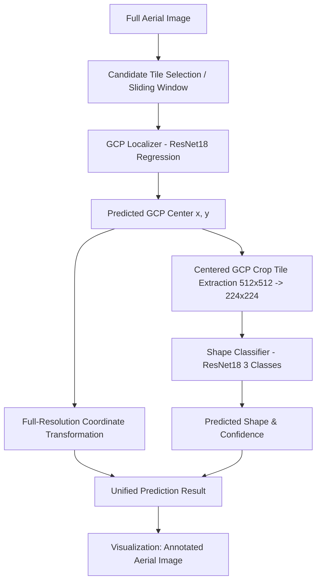

# GCP Localizer & Shape Classifier

A modular, reproducible PyTorch computer-vision repository for Ground Control Point (GCP) detection, coordinate localization, and geometric shape classification in high-resolution aerial imagery.

---

## 1. Project Overview

Ground Control Points (GCPs) are physical target markers placed on terrain during aerial surveys for precise geographic referencing and photogrammetry alignment. In aerial drone surveys, markers typically exhibit one of three standardized geometric shapes:
1. **Cross**
2. **Square**
3. **L-Shape**

This repository provides an end-to-end modular pipeline that:
- Detects the candidate GCP marker location in full-resolution aerial imagery.
- Regresses high-precision $(x, y)$ coordinates in the **original full-resolution image coordinate space**.
- Extracts a centered crop tile and classifies marker shape (`Cross`, `Square`, or `L-Shape`) using a ResNet-18 backbone.
- Outputs prediction JSON along with an annotated visual overlay.
- Hosts an interactive demonstration using **Streamlit**.

---

## 2. Architecture

The inference pipeline combines coordinate regression with multi-class shape classification:



### Models & Components

| Component | Architecture | Objective / Loss | Input Size | Output |
| :--- | :--- | :--- | :--- | :--- |
| **GCP Localizer** | ResNet-18 Backbone + 2-layer MLP head | Smooth L1 / L1 Regression | $224 \times 224 \times 3$ | Relative $(\Delta x, \Delta y)$ coordinates |
| **GCP Shape Classifier** | ResNet-18 Backbone + Linear(512, 3) | Cross-Entropy Loss | $224 \times 224 \times 3$ | Class logits (`L-Shape`, `Square`, `Cross`) |
| **Marker Filter (Optional)** | ResNet-18 Backbone + Linear(512, 2) | Binary Cross-Entropy | $224 \times 224 \times 3$ | Marker presence probability |

### Label Encoding (Verified)

In accordance with project conventions and dataset annotations:
- `0` $\rightarrow$ **`L-Shape`**
- `1` $\rightarrow$ **`Square`**
- `2` $\rightarrow$ **`Cross`**

---

## 3. Repository Structure

```text
gcp_localizer/
├── app/
│   └── streamlit_app.py            # Streamlit interactive visual demonstration
├── artifacts/
│   ├── figures/                    # Preprocessing verification figures
│   ├── models/                     # Saved model checkpoints (.pt)
│   └── plots/                      # Evaluation curves and visualizations
├── configs/
│   ├── base.yaml                   # Unified configuration (localizer + classifier)
│   ├── localizer.yaml              # Localizer hyperparameters
│   └── classifier.yaml             # Shape classifier hyperparameters
├── data/
│   ├── raw/                        # Raw images and gcp_marks.json
│   └── processed/                  # Leakage-free npz tile crops
├── models/
│   ├── localizer.pt                # Localizer regression model checkpoint
│   └── classifier.pt               # 3-Class shape classifier checkpoint
├── scripts/
│   ├── prepare_data.py             # Data preparation & leakage-free split
│   ├── train.py                    # Unified training CLI runner
│   ├── train_localizer.py          # Localizer regression training CLI
│   ├── train_classifier.py         # Shape classifier training CLI
│   ├── predict.py                  # Single-image unified inference CLI
│   └── evaluate.py                 # Evaluation & metrics reporting script
├── src/
│   └── gcp_localizer/
│       ├── data/
│       │   ├── annotations.py      # JSON annotation loading & pandas utils
│       │   ├── datasets.py         # PyTorch Datasets (FastGCP, Shape, RawShape)
│       │   ├── preprocessing.py    # Leakage-free cropping & tile extraction
│       │   └── splits.py           # Image-level split to prevent data leakage
│       ├── models/
│       │   ├── localizer.py        # GCPLocalizer regression model
│       │   └── classifier.py       # GCPClassifier & GCPShapeClassifier
│       ├── training/
│       │   ├── localizer.py        # Localizer training loop
│       │   └── classifier.py       # Shape classifier training & metric reporting
│       ├── inference/
│       │   ├── predictor.py        # Unified GCPPredictor pipeline
│       │   └── visualization.py    # Reusable annotation overlay generator
│       └── evaluation/
│           ├── metrics.py          # MAE & Euclidean distance calculations
│           └── visualization.py    # Grid and confusion matrix visualizers
├── tests/
│   ├── test_annotations.py         # Annotation parser tests
│   ├── test_datasets.py            # PyTorch dataset tests
│   ├── test_models.py              # Architecture forward pass tests
│   ├── test_preprocessing.py       # Cropping & coordinate normalization tests
│   ├── test_shape_classifier.py    # Shape classifier output & label mapping tests
│   └── test_inference.py           # Unified inference & coordinate preservation tests
├── pyproject.toml
├── requirements.txt
└── README.md
```

---

## 4. Setup & Installation

Clone the repository and install dependencies in editable mode:

```bash
git clone https://github.com/user/gcp_localizer.git
cd gcp_localizer

# Install package and dependencies in a virtual environment
python -m venv .venv
source .venv/bin/activate
pip install -e .[dev]
```

---

## 5. Model Training

### Training the Localizer (Coordinate Regression)

Train the localizer to regress marker center coordinates:

```bash
python scripts/train_localizer.py --config configs/localizer.yaml
```

The best checkpoint is saved to `artifacts/models/best_localizer_model.pt` (and `models/localizer.pt`).

### Training the Shape Classifier

Train the 3-class shape classifier (`L-Shape`, `Square`, `Cross`):

```bash
# Using the default configuration
python scripts/train_classifier.py --config configs/classifier.yaml

# Or using unified base configuration
python scripts/train_classifier.py --config configs/base.yaml

# Specifying custom dataset directories
python scripts/train_classifier.py \
    --data data/raw/train_dataset \
    --annotations data/raw/gcp_marks.json \
    --config configs/base.yaml

# Quick synthetic smoke test / validation mode
python scripts/train_classifier.py --synthetic --epochs 5
```

During training, the script evaluates validation performance after each epoch and reports:
- Validation Loss
- Classification Accuracy
- Macro Precision
- Macro Recall
- Macro F1 Score
- Confusion Matrix

The best checkpoint is saved to `models/classifier.pt` and `artifacts/models/best_shape_model.pt`.

---

## 6. Running Unified Inference

### Python API

```python
from gcp_localizer.inference.predictor import GCPPredictor
from gcp_localizer.inference.visualization import annotate_prediction

# Instantiate predictor (automatically locates default checkpoints)
predictor = GCPPredictor()

# Run inference on any aerial image (path or RGB numpy array)
result = predictor.predict("path/to/aerial_image.jpg")
print(result)

# Or predict and generate the annotated image in one call
result, annotated_img = predictor.predict_and_annotate(
    "path/to/aerial_image.jpg",
    save_path="output/annotated.png"
)
```

### Command-Line Interface (CLI)

Run inference directly from terminal:

```bash
python scripts/predict.py \
    --image path/to/aerial_image.jpg \
    --output output/annotated.png
```

### Expected Output

Console JSON output:

```json
{
    "x": 1832.42,
    "y": 1044.17,
    "shape": "L-Shape",
    "confidence": 0.9630,
    "class_id": 0
}
```

> **Coordinate System Guarantee:** The returned $(x, y)$ coordinates refer to the **original full-resolution aerial image coordinate space**, not model crop coordinates.

---

## 7. Interactive Streamlit Demo

Launch the web application:

```bash
streamlit run app/streamlit_app.py
```

### Features:
1. **Drag-and-drop Image Upload**: Upload any aerial or drone image (`JPG`, `PNG`, `TIF`, `BMP`).
2. **Demo Mode**: Built-in synthetic aerial demo generator for one-click testing without external files.
3. **Dual View**: Side-by-side display of original aerial image and detected marker annotation.
4. **Metric Dashboard**: Clean presentation of estimated coordinates, shape classification, and confidence.
5. **Error Guarding**: Graceful warning and error messaging.

---

## 8. Model Checkpoint Files

Model weights are organized under `models/` and `artifacts/models/`:

- `models/localizer.pt`: ResNet-18 coordinate localizer regression weights.
- `models/classifier.pt`: ResNet-18 3-class shape classifier weights (`L-Shape`, `Square`, `Cross`).
- `artifacts/models/best_localizer_model.pt`: Checkpoint produced by `train_localizer.py`.
- `artifacts/models/best_shape_model.pt`: Checkpoint produced by `train_classifier.py`.
- `artifacts/models/best_classifier_model.pt`: Binary marker presence classifier (used for coarse aerial tiling).

---

## 9. Automated Testing Suite

Run the complete test suite with `pytest`:

```bash
pytest
```

The test suite covers:
- Output tensor shapes and configurable classes for `GCPShapeClassifier`.
- Label encoding verification (`L-Shape: 0`, `Square: 1`, `Cross: 2`).
- Inference prediction schemas (`x`, `y`, `shape`, `confidence`).
- Strict coordinate system preservation across full-resolution transformations.
- Visual annotation rendering and export.
